<div align="center">

# Skyday Finance

**Every pound, euro, zloty, franc, and dollar in one calm, self-hosted ledger.**

An open-source personal, shared household, and company financial engine featuring **3-tier cashflow Sankey routing**, **automatic sinking-fund ("Preserve") accruals**, **pre-payday runway forecasting**, **10Y–20Y net-worth & depreciation modeling**, and a **native Model Context Protocol (MCP) server** for zero-friction AI receipt and bank statement ingestion.

[](./tsconfig.json)
[](./src/client/App.tsx)
[](./src/server/index.ts)
[](./src/server/db.ts)
[](./src/server/mcp.ts)
[](./LICENSE)

[**Visual Tour**](#-visual-tour--capabilities) · [**AI / MCP Ingestion**](#6-turn-invoice-photos--bank-statements-into-reconciled-ledgers-mcp) · [**Quick Start**](#-quick-start) · [**Architecture**](#9-zero-lock-in-open-source-typescript-architecture)

</div>

---

## 🎬 Walkthrough Preview & Overview

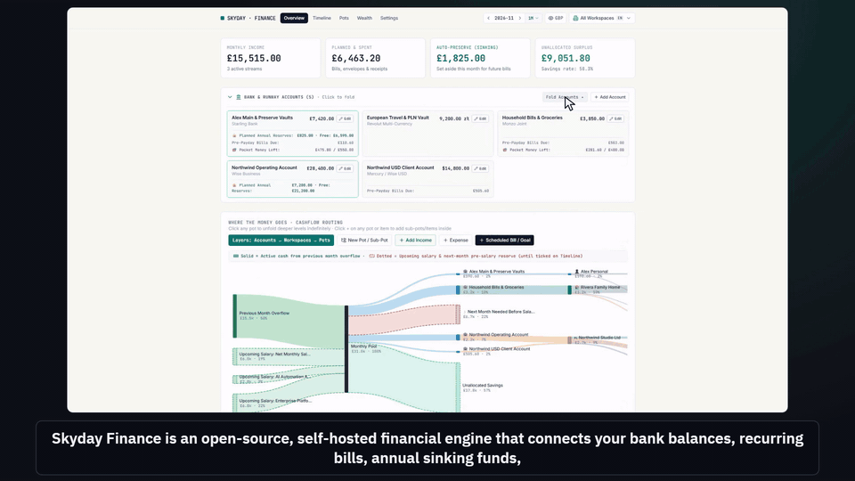

| Section | Focus |
| :--- | :--- |
| **[1. One Calm Ledger](#1-every-pound-euro-zloty--dollar-in-one-calm-ledger)** | Real bank balances, locked annual reserves, pre-payday buffer & interactive 3-tier cashflow Sankey |
| **[2. Pre-Payday Runway & Advisory](#2-pre-payday-runway-locked-sinking-reserves--automated-financial-advisory)** | Automatic monthly Preserve sinking-fund slices, locked saver alerts, daily pocket money & runway curve |
| **[3. Home Budget & Nested Pots](#3-infinite-pot-hierarchy-progressive-envelopes--attachment-vault)** | Infinite nested pots, progressive envelopes without double-counting & SHA-256 receipt/invoice vault |
| **[4. Company Treasury & Runway](#4-run-your-company-runway-tax-reserves--cloud-commitments)** | Multi-currency operating accounts, VAT/tax reserves, GPU/cloud commitments & direct `Manage / Cancel` links |
| **[5. Wealth, Property & Depreciation](#5-compound-investments-property-equity-depreciation--20-year-wealth-trajectory)** | `-10Y` historical reconstruction to `+20Y` compound growth, depreciating belongings & live loan amortization |
| **[6. AI Agent & MCP Ingestion](#6-turn-invoice-photos--bank-statements-into-reconciled-ledgers-mcp)** | One-click bootstrap prompt for local LLMs, Claude Code, Codex, or Antigravity to ingest receipt photos & 12M CSVs |
| **[7. Multi-Workspace Collaboration](#7-share-with-partners-family-friends--companies)** | Share with partners, family, friends & companies (`50/50`, income-proportional, or custom splits + privacy scopes) |
| **[8. Currencies, Languages & `% ONLY` Mode](#8-switch-currencies-languages---only-privacy-mode-in-one-click)** | Live FX conversion (`GBP`, `EUR`, `PLN`, `USD`, `CHF`), instant `EN`/`PL` switch & Base-100 `% ONLY` privacy shield |
| **[9. Zero Lock-In Architecture](#9-zero-lock-in-open-source-typescript-architecture)** | Clean TypeScript monorepo, integer minor-unit engine, `node:sqlite` WAL, single Docker container & atomic backups |

<details>
<summary><strong>🖼️ View Full 20-Frame Feature Storyboard / Contact Sheet</strong></summary>
<br />

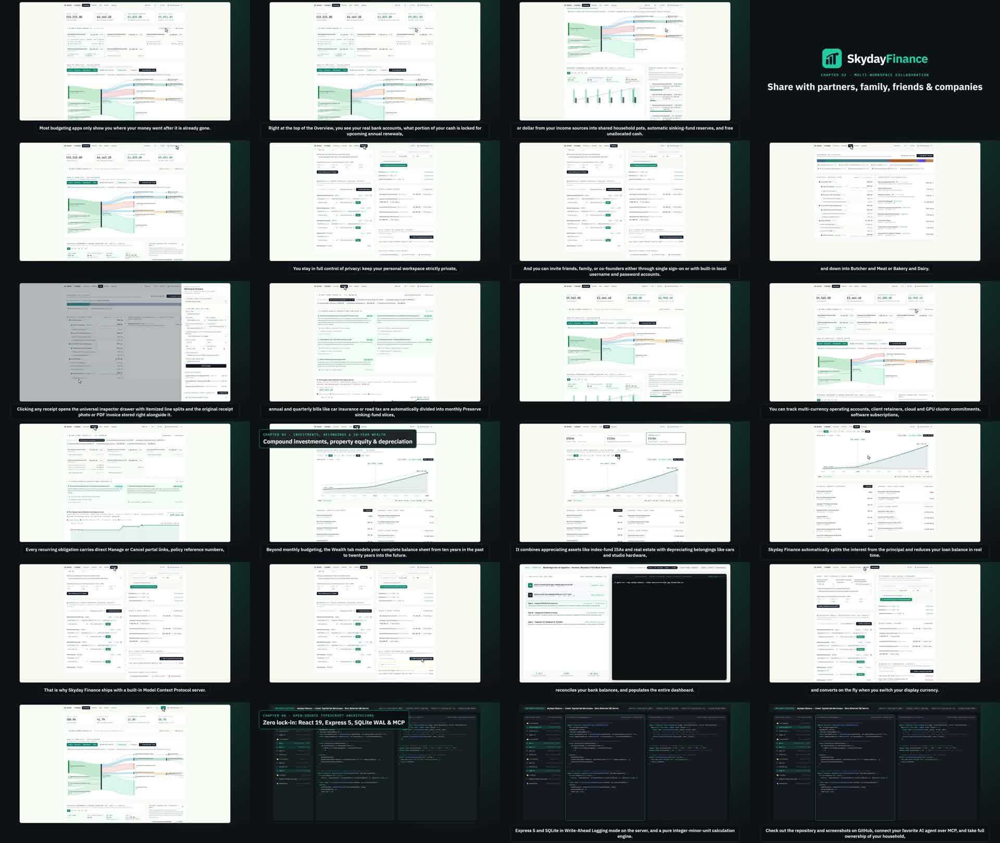

</details>

---

## ✨ Visual Tour & Capabilities

### 1. Every Pound, Euro, Zloty & Dollar in One Calm Ledger

Most budgeting apps only show where your money went after it is already gone. Skyday Finance connects your live bank balances, recurring obligations, annual sinking funds, and long-term wealth into a single forward-looking dashboard.

- **Bank & Runway Accounts**: Inspect real bank balances alongside the exact portion of cash locked for upcoming annual renewals.
- **3-Tier Cashflow Sankey (`Accounts → Workspaces → Pots`)**: Traces every unit of currency from previous-month overflow (solid ribbons) and upcoming salaries (dotted ribbons) into workspace pools, pre-salary reserves, nested pots, and unallocated savings.
- **Multi-Horizon Performance Zoom**: Inspect earned vs. spent & preserved trends across `1M`, `3M`, `6M`, `12M`, `5Y`, or `10Y`.

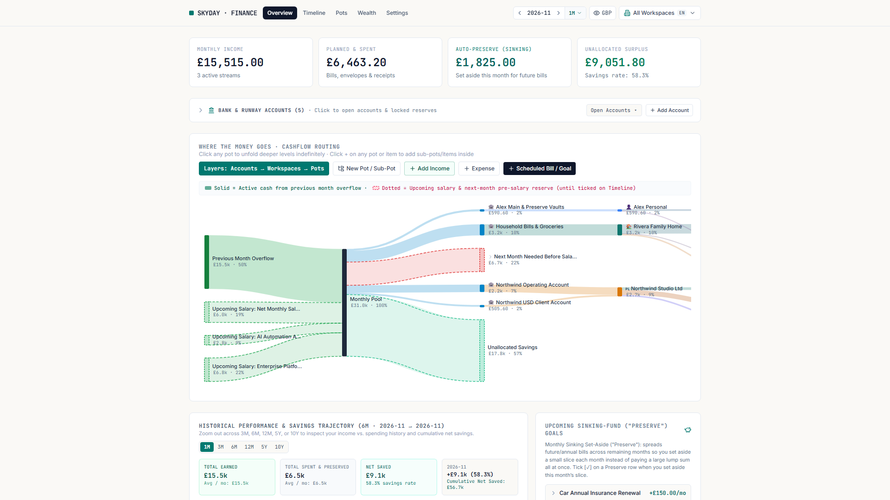

---

### 2. Pre-Payday Runway, Locked Sinking Reserves & Automated Financial Advisory

On the **Timeline** tab, annual, quarterly, and multi-month bills (such as car insurance, road tax, or corporation tax) are automatically divided into monthly **Preserve** sinking-fund slices:

$$\text{Monthly Preserve Slice} = \left\lceil \frac{\text{Target Amount} - \text{Already Preserved}}{\text{Months Until Due}} \right\rceil$$

- **Automated Financial Advisory & Money Flow Alerts**: Highlights earmarked sinking reserves locked inside bank accounts, tracks daily **Pocket Money** small-spending allowances until payday, and calculates your **Month-End Savings Sweep** opportunity.
- **Pre-Payday Cash Runway Curve**: Projects day-by-day liquidity from Day 1 to Day 31—filterable per bank account or combined—warning you weeks in advance if an account needs a top-up before salary arrives.
- **Payment Reset Engine**: Ticking `[✓] Mark as Paid` logs the occurrence, updates your live bank balance, resets the Preserve counter, and advances the next due date automatically.

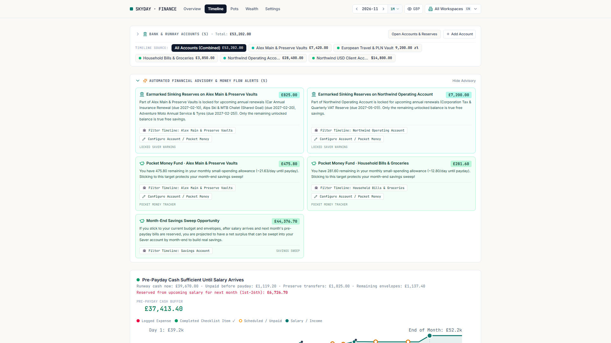

---

### 3. Infinite Pot Hierarchy, Progressive Envelopes & Attachment Vault

For household and personal budgeting, **Pots** can be nested to any depth (e.g., `Home & Utilities → Food & Groceries → Butcher & Meat` or `Bakery & Dairy`).

- **Progressive Granularity Without Double-Counting**: Start with a rough monthly envelope (e.g., `£600/mo` for `Food & Groceries`) and log itemized receipts later. An envelope pot contributes $\max(\text{Envelope Estimate}, \text{Actual Tracked Spend})$ so estimates and receipts never double-count.
- **Universal Inspector Drawer & Attachment Vault**: Clicking any receipt or bill opens the side inspector with itemized line splits, live bank account balance sync, linked loan/mortgage paydown, direct provider URLs, and attached PDF invoices or receipt photos stored on disk with SHA-256 integrity.

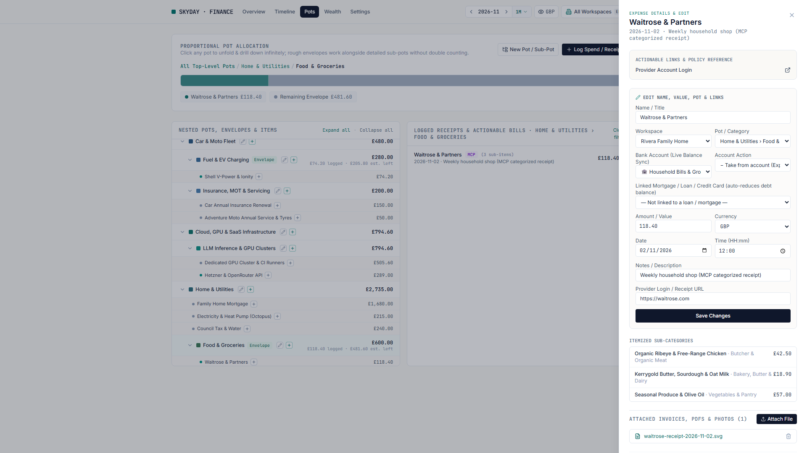

---

### 4. Run Your Company Runway, Tax Reserves & Cloud Commitments

Switch to a company workspace (such as `Northwind Studio Ltd`) for a dedicated corporate treasury view, or blend it with your personal and household finances in **All Workspaces**.

- **Multi-Currency Operating Accounts**: Track GBP, EUR, PLN, USD, and CHF operating accounts, client retainers, GPU/cloud commitments, and SaaS subscriptions.
- **Locked Tax & Annual Reserves**: Automatically earmark quarterly VAT and annual corporation tax reserves inside your operating account so you always see true free cash vs. locked reserves.
- **Zero Surprise Renewals**: Every recurring obligation stores direct `Manage / Cancel` portal links, policy reference numbers, and renewal notice windows.

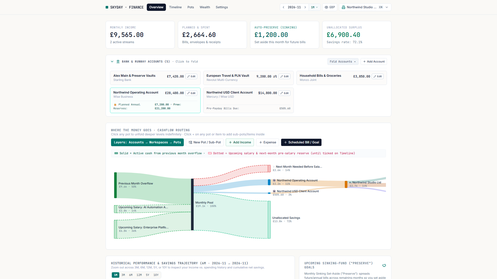

---

### 5. Compound Investments, Property Equity, Depreciation & 20-Year Wealth Trajectory

Beyond monthly cashflow, the **Wealth** tab models your complete balance sheet from **10 years in the past (`-10Y`)** to **20 years into the future (`+20Y`)**.

- **Appreciating Assets & Depreciating Belongings**: Combines real estate, pensions/SIPPs, and index-fund ISAs (`+3.5%` to `+7.0%/yr` compound curves) with depreciating vehicles, motorcycles, E-MTBs, and studio/homelab hardware (`-11%` to `-22%/yr` bounded by realistic resale floors).
- **Live Mortgage & Loan Amortization**: When you mark a mortgage or loan payment as paid on the monthly checklist, Skyday Finance automatically splits interest from principal (`APR / 12`) and reduces your liability balance in real time.

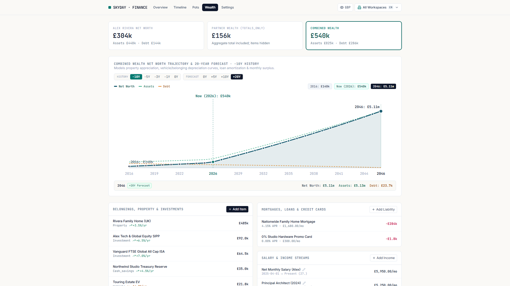

---

### 6. Turn Invoice Photos & Bank Statements into Reconciled Ledgers (MCP)

Manual data entry is the biggest friction in personal and company finance. Skyday Finance ships with a built-in **Model Context Protocol (MCP)** JSON-RPC 2.0 server at `POST /api/mcp` plus a local stdio file-upload bridge (`scripts/skyday-finance-mcp.mjs`).

- **Model-Agnostic AI Harness Support**: Works out of the box with local open-weights models (Ollama / Qwen / Llama), Claude Code / Claude Desktop, Codex, Cursor, and Antigravity.
- **End-to-End Statement & Receipt Automation**: Drop a camera photo of a supermarket receipt, a PDF supplier invoice, or a 12-month multi-account CSV bank statement into your agent. The agent inspects your pot tree, creates missing sub-pots, categorizes itemized splits, uploads the original PDF/photo to the vault, ticks recurring bills, and reconciles your bank balances to the penny.

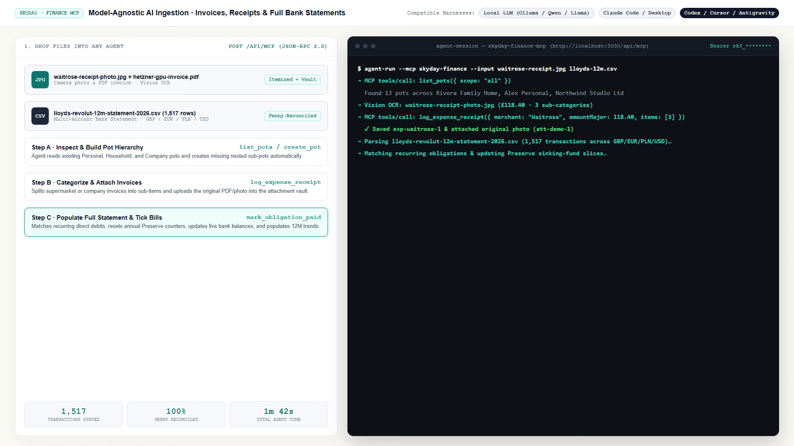

---

### 7. Share with Partners, Family, Friends & Companies

Real life rarely fits in a single bank account. Create unlimited workspaces—personal spaces, a shared family home, a group ski trip with friends, or multiple companies.

- **Flexible Expense & Bill Splitting**: Split shared workspace obligations and receipts `50 / 50`, proportionally to each partner's net monthly income, or by a custom basis-point percentage.
- **Granular Partner Privacy Scopes**: Keep your personal workspace strictly `private`, share `totals_only` (so combined household net worth stays accurate while individual items remain private), or grant `readonly` / `editor` access.
- **SSO + Built-In Local Accounts**: Authenticate via Authentik OAuth2/OIDC (`Authorization Code + PKCE S256` & ForwardAuth) or create built-in local username/password invites for friends and family in one click.
- **One-Click MCP Agent Bootstrap**: Mint a scoped `Bearer skf_...` key and copy a complete agent bootstrap prompt directly from **Settings**.

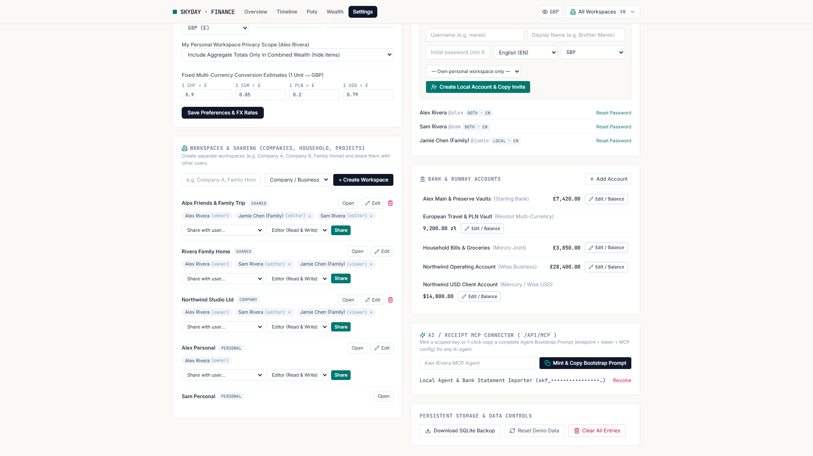

---

### 8. Switch Currencies, Languages & `% ONLY` Privacy Mode in One Click

- **Native Multi-Currency Engine**: Every income stream, obligation, receipt, asset, and liability stores its native currency (`GBP`, `EUR`, `PLN`, `USD`, `CHF`) in integer minor units and converts on the fly when you switch your display currency.
- **Instant `EN` / `PL` Localization**: Switch the entire interface between English and Polish in the top navbar (`src/client/i18n.ts`). Adding another language or currency takes a single dictionary entry.
- **`% ONLY` Friends Privacy Mode (Hotkey `P`)**: Press `P` or click the `%` badge in the top bar before screen-sharing or livestreaming. Every nominal currency figure converts into a percentage of monthly income (`100.0%` pool, `58.3%` savings rate) and a **Base-100** wealth index while preserving all Sankey proportions and charts.

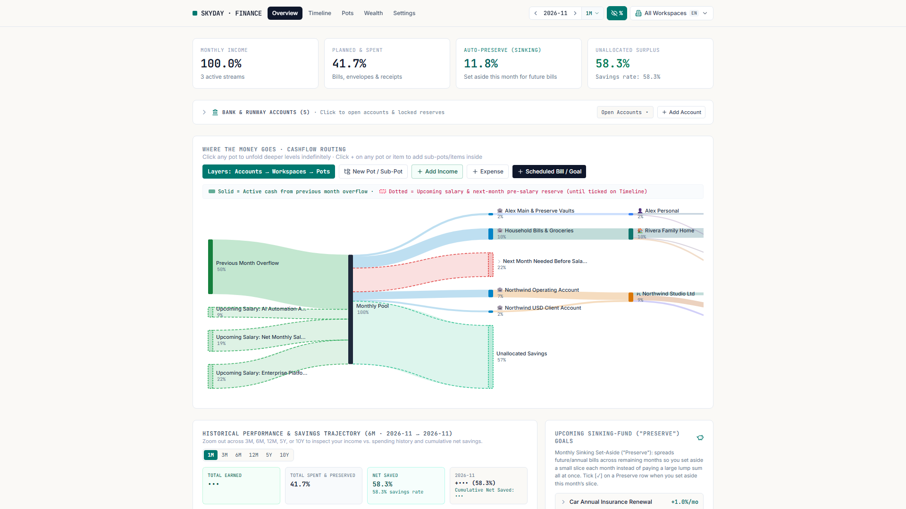

---

### 9. Zero Lock-In Open-Source TypeScript Architecture

Skyday Finance is designed as a clean, auditable TypeScript monorepo with zero external database servers required:

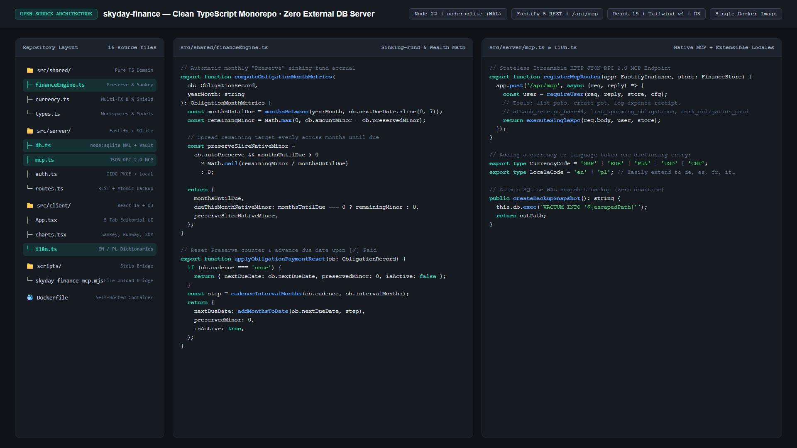

```text
skyday-finance/
├── src/
│   ├── shared/
│   │   ├── financeEngine.ts    # Pure integer minor-unit Preserve, Sankey, Runway & 20Y Wealth math
│   │   ├── currency.ts         # Multi-FX conversion & % ONLY privacy shield formatters
│   │   └── types.ts            # Shared domain models across client, server & MCP
│   ├── server/
│   │   ├── db.ts               # Native Node 22 node:sqlite in WAL mode + SHA-256 attachment vault
│   │   ├── mcp.ts              # Stateless Streamable HTTP JSON-RPC 2.0 MCP server (/api/mcp)
│   │   ├── auth.ts             # Authentik OIDC + PKCE S256, ForwardAuth, Scrypt local auth & Bearer keys
│   │   ├── routes.ts           # Fastify 5 REST API, advisory generator & atomic SQLite/JSON backups
│   │   └── index.ts            # Fastify entrypoint serving API + static SPA bundle
│   └── client/
│       ├── App.tsx             # 5-tab editorial UI (Overview, Timeline, Pots, Wealth, Settings)
│       ├── charts.tsx          # Custom D3 Sankey, Pre-Payday Runway, Proportional Pots & 20Y Wealth charts
│       ├── QuickAddInline.tsx  # Inline quick-entry modals & forms
│       ├── i18n.ts             # English (EN) & Polish (PL) translation dictionaries
│       └── api.ts              # Typed REST & multipart client
├── scripts/
│   └── skyday-finance-mcp.mjs  # Local stdio MCP bridge with direct file upload helper
├── tests/
│   ├── financeEngine.test.ts   # Unit tests for Preserve accruals, progressive pots & wealth curves
│   └── api.test.ts             # End-to-end API, workspace ACL, multi-currency & MCP integration tests
├── Dockerfile                  # Multi-stage Node 22 Alpine production container
└── docker-compose.monolith.yml # Self-hosted Docker Compose deployment
```

---

## 🚀 Quick Start

### Prerequisites
- **Node.js 22+** (uses the built-in `node:sqlite` module—no external Postgres/MySQL server or native C++ compilation needed).

### 1. Run Locally in Development Mode

```bash
# Install dependencies
npm install

# Run the test suite (unit + end-to-end API & MCP tests)
npm test

# Start the Fastify API server (port 3020, AUTH_MODE=dev) and Vite frontend
npm run dev:api
npm run dev:web
```

Or build and run the single-process production server locally:

```bash
npm run build
AUTH_MODE=dev PORT=3020 DATA_DIR=./data npm start
```

Then open **`http://localhost:3020`** in your browser. On a fresh database, Skyday Finance seeds a starter multi-workspace household sample that you can explore immediately or clear/reset anytime from **Settings → Persistent Storage & Data Controls**.

### 2. Self-Host with Docker

```bash
docker build -t skyday-finance:latest .

docker run -d \
  --name skyday-finance \
  -p 3020:3020 \
  -v $(pwd)/data:/data \
  -e AUTH_MODE=dev \
  -e SESSION_SECRET=$(openssl rand -hex 32) \
  skyday-finance:latest
```

For production deployments behind Authentik SSO (`OAuth2/OIDC + PKCE S256` or reverse-proxy ForwardAuth), copy [`.env.example`](./.env.example) to `.env` and set `AUTH_MODE=authentik`.

---

## 🤖 Connecting an AI Agent via MCP

1. Open **Settings → AI / Receipt MCP Connector (`/api/mcp`)**.
2. Enter a key name (e.g. `Local Agent & Bank Statement Importer`) and click **Mint & Copy Bootstrap Prompt**.
3. Add the MCP server to your AI harness configuration (or paste the bootstrap prompt directly into your agent):

```json
{
  "mcpServers": {
    "skyday-finance": {
      "command": "node",
      "args": ["./scripts/skyday-finance-mcp.mjs"],
      "env": {
        "SKYDAY_FINANCE_URL": "http://localhost:3020",
        "SKYDAY_FINANCE_TOKEN": "skf_your_minted_token_here"
      }
    }
  }
}
```

### Available MCP Tools (`POST /api/mcp`)

| Tool Name | Description |
| :--- | :--- |
| `get_monthly_budget` | Returns monthly income, planned obligations, Preserve sinking slices, runway, and nested pot summaries |
| `list_pots` | Lists all hierarchical pots and sub-pots across accessible workspaces (`personal`, `shared`, `company`) |
| `create_pot` | Creates a top-level or nested sub-pot with optional monthly envelope mode |
| `log_expense_receipt` | Logs a categorized expense with optional itemized sub-items (`items[]`) and currency conversion |
| `attach_receipt_file` | Uploads a local PDF invoice or receipt photo from disk directly into the SHA-256 attachment vault |
| `attach_receipt_base64` | Attaches a base64-encoded receipt image or PDF document to an expense, obligation, or asset |
| `list_upcoming_obligations` | Lists active recurring bills and multi-month Preserve sinking-fund goals with remaining slices |
| `mark_obligation_paid` | Marks a bill/obligation as paid, updates the linked bank balance, amortizes linked loans, and resets Preserve |

---

## 📄 License

Released under the [MIT License](./LICENSE).
